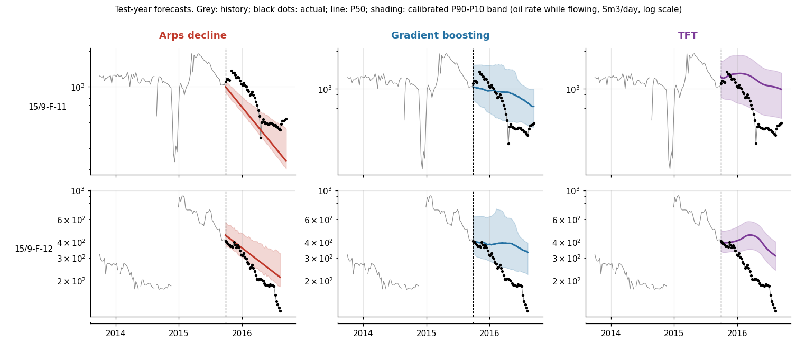
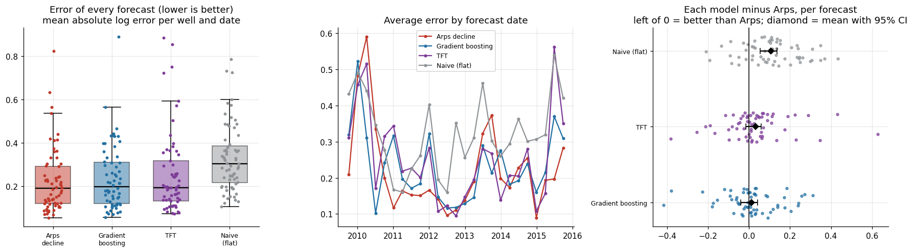
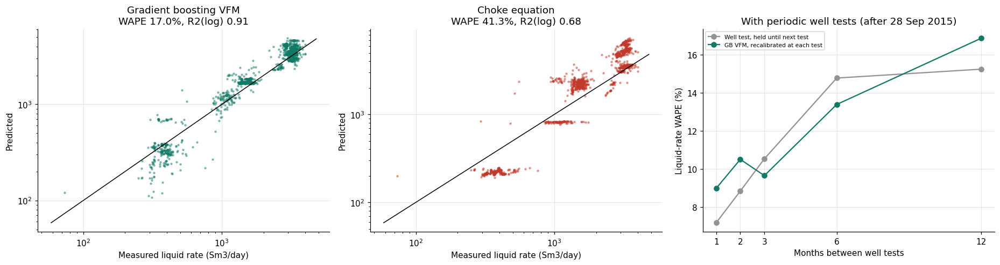

# Volve Production Forecasting: Physics vs Machine Learning

Probabilistic oil production forecasting (P10/P50/P90) on Equinor's open **Volve** field data, North Sea, 2008 to 2016.

The project asks two questions:

1. **Can machine learning beat classic Arps decline curve analysis at forecasting a year of oil production?**
2. **If not, where does ML actually add value for a production team?**

Every model is tested the same strict way: it only sees data from before its forecast date, and it is scored on what happened next.



## Part 1: Year-ahead forecasting

Three methods, each producing a P10/P50/P90 range:

| Method | What it is |
| --- | --- |
| Arps decline | Hyperbolic decline curve (Arps, 1945), bootstrap uncertainty |
| Gradient boosting | Quantile `HistGradientBoostingRegressor` on lagged rates, water cut, choke, wellhead pressure |
| Temporal Fusion Transformer | Built in PyTorch: gated residual networks, variable selection, attention, quantile loss |

Prediction bands are calibrated on a practice year (Oct 2014 to Sep 2015) with conformal adjustment, then scored on the test year (Oct 2015 to Sep 2016).

**Test year results (5 wells, 52 weeks)**

| Method | Weekly MAPE | Cumulative error | P10 to P90 coverage, calibrated (target 80%) |
| --- | --- | --- | --- |
| Arps decline | 26.7% | -18.1% | 58% |
| Gradient boosting | 40.4% | +22.9% | 74% |
| Temporal Fusion Transformer | 44.3% | +39.3% | 65% |

**Rolling backtest:** all models were re-run from 25 quarterly forecast dates (2009 to 2015). No ML model beat Arps with statistical confidence (block-bootstrap 95% CI on the paired difference includes zero). All models beat a flat "no change" baseline.

**Why ML lost:** rising water cut. On F-11 and F-12, water cut climbed toward 80 to 90% during the test year. Arps followed the decline; the ML models forecast a plateau that did not come.



## Part 2: Where ML earns its place

| Task | ML result | Classic baseline |
| --- | --- | --- |
| Next-month (4-week) oil volume, 198 forecasts | 5.7% median error, beats Arps 68% of the time | Arps 9.0%, flat 7.6% |
| Virtual flow meter, liquid rate | 17.0% WAPE (21.5% on an unseen well) | Choke equation 41.3% (37.1%) |
| Water-cut forecast, 52 weeks | 7.3 points mean error | Fitted trend 11.3, flat 9.2 |
| Year-ahead volume, Arps + GB average | 15.5% error | Arps alone 17.8% (difference not yet significant) |

Also included:

- **Physics-constrained ML:** monotonic constraints so forecasts never rise with horizon or with faster water-cut growth.
- **Anomaly detection:** virtual-meter residuals plus an isolation forest across 7,609 well-days.
- **Explainability:** permutation importance, partial dependence and SHAP.
- **MLOps simulation:** monthly retraining (Jan 2015 to Jul 2016) with a versioned model registry, data-drift checks and an accuracy alarm.



## Honest limits

- Five producing wells is a small sample. Differences between the year-ahead methods are not statistically significant.
- The virtual flow meter works for **liquid** rate. Oil-rate estimates were weaker than a stale well test, because no sensor measures water cut directly.
- With monthly well tests, a held well test (7.2% error) still beats the recalibrated ML meter (9.0%). The meter pulls ahead when tests are 3 to 6 months apart.
- Arps b sat at its bounds on 4 of 5 wells: near 0 (exponential) on three watered-out wells, and 1.0 on two wells with a restart shortly before the forecast date.

## Repository layout

```
notebooks/
  volve_production_forecast_ML_Part1.ipynb   # data prep, Arps, gradient boosting, TFT, backtests
  volve_production_forecast_ml_part2.ipynb   # hybrids, short horizon, water cut, VFM, anomalies, MLOps
figures/                                      # key charts
requirements.txt
```

## How to run

1. Download `Volve production data.xlsx` from [Equinor's Volve data village](https://www.equinor.com/energy/volve-data-sharing) (free registration) and place it in a Google Drive folder.
2. Open either notebook in Google Colab and set `PROJECT` and `SRC` in the paths cell to your folders.
3. Run all cells. Part 1 takes about 30 minutes on CPU (the Transformer and rolling backtest are the slow parts).

The dataset is not included in this repository. Please obtain it from Equinor.

## Data and credit

Data: Equinor and the Volve license partners, released under the Equinor Open Data Licence. Thanks to Equinor for making Volve public.

## Author

Joseph Lebbie, Petroleum Engineer (MS, University of Houston) and AI/ML researcher.
LinkedIn: [add your profile link]
